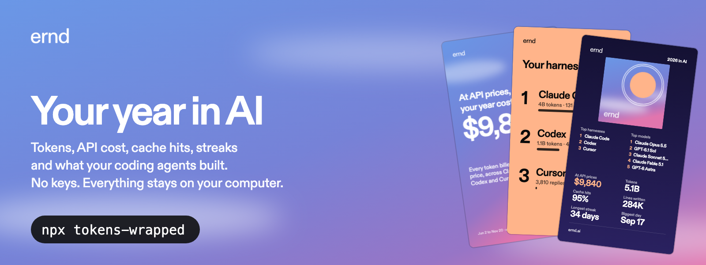
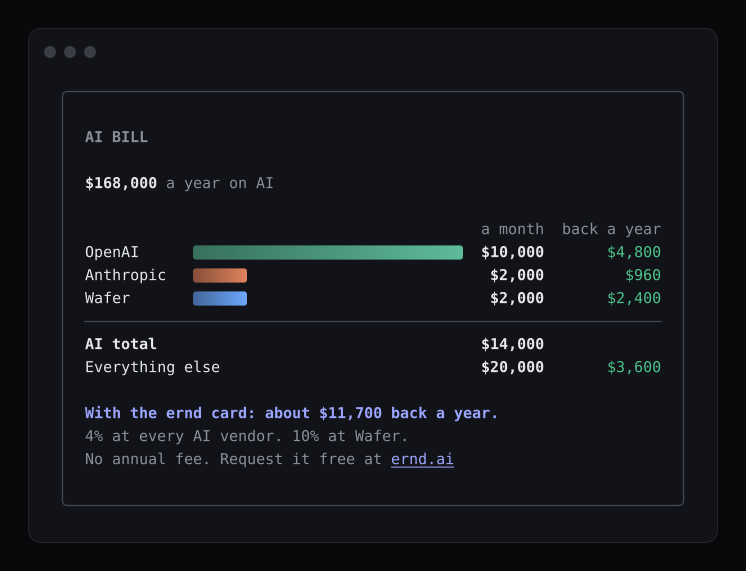

<p align="center"></p>

<p align="center">
  <a href="https://github.com/erndai/tokens-wrapped/actions/workflows/ci.yml"></a>
  
  <a href="SECURITY.md"></a>
  
</p>

# tokens-wrapped

Your year in AI, from the logs your coding agents already keep ([tokenswrapped.com](https://tokenswrapped.com)).
One command, no keys:

```sh
npx tokens-wrapped
```

It reads this year's usage from Claude Code, Codex, OpenCode and the other agents on your computer, prints a
summary, and opens a recap you can tap through and post.

## Everything stays on your computer

- It reads agent logs and databases on your machine, read-only, and makes no network requests at all.
- It keeps only numbers, model names and tool names. It never reads out your prompts or code.
- Nothing is saved except the recap page, one local file.
- The only thing that ever leaves is the card you choose to post: "Post on X" uploads that one image so X can show
  it, and it's deleted after 90 days ([worker/index.js](worker/index.js)).
- Zero dependencies, no telemetry. Every release is published from this repo by GitHub Actions with npm
  provenance. Details: [SECURITY.md](SECURITY.md).

## What's in the recap

| Card | From |
|---|---|
| At API prices: what the year would have cost, next to a $20, $100 or $200 plan | Tokens by model x public list prices ([src/local/prices.js](src/local/prices.js)) |
| Tokens, top models, cache hit rate | Each agent's usage records |
| Your harnesses | Which coding agents you used, by tokens and days |
| Your biggest day, your rhythm (streak, busiest hour) | Timestamps, in your local time |
| What your agents wrote: lines, files, languages, sessions | The agents' edit and write tool calls |
| Your AI personality, summary, a wide card for X | All of the above |

Supported: Claude Code, Codex, Cursor, OpenCode, Kilo Code, Cline, Roo Code, Pi, Gemini CLI, Qwen Code, Copilot CLI,
Droid, Kimi CLI, Goose and Crush. Notes:

- Claude Code (and Gemini CLI) delete logs after 30 days by default, so the recap starts at your oldest log.
- Cursor keeps no token counts on your computer, so it shows messages and AI-written lines, not tokens. Crush stores
  cost but not token totals. Amp keeps its history on its servers, so it can't be read locally.
- "At API prices" is an estimate: it ignores long-context tiers, batch and fast modes.

## Team mode: org admin keys

For a whole organization's spend and usage from the OpenAI and Anthropic admin reports instead of one
computer's logs: `npx tokens-wrapped --keys` asks for the keys, hidden. In this mode the keys go only to
`api.openai.com` and `api.anthropic.com` (see every request first with `npx tokens-wrapped --dry-run --keys`).


Keys in the environment instead of the prompt (`read -rs` keeps them out of your shell history):

```sh
read -rs OPENAI_ADMIN_KEY && export OPENAI_ADMIN_KEY         # OpenAI org admin key, sk-admin-...
read -rs ANTHROPIC_ADMIN_KEY && export ANTHROPIC_ADMIN_KEY   # Anthropic Admin API key, sk-ant-admin01-...
npx tokens-wrapped --share              # recap
npx tokens-wrapped --months 3 --by-model  # terminal card only: last 3 full months, top models
```

No keys, your own monthly numbers (USD):

```sh
npx tokens-wrapped --openai 8000 --anthropic 4000 --wafer 2000 --other 20000
```

Each provider in `src/rates.js` is a flag: `--openai --anthropic --wafer --hopper --conifer --superserve
--agentphone --agent37 --nodus --trace --firecrawl`. `--ai` is any other AI vendor, `--other` is card spend
that isn't AI. Flags and keys mix: a flag wins over the key for the same provider.

Also: `--json`, `--no-color` (or `NO_COLOR=1`), `--offline` (ignore keys), `--help`, `--version`.

The terminal card:



Needs Node 18 or newer. From source: `git clone`, then `node bin/tokens-wrapped.js`.

Color follows the terminal: 24-bit when `COLORTERM=truecolor`, then 256, then 16 colors. Pipes get plain
text unless `FORCE_COLOR` is set.

## Where the year-in-AI numbers come from

`--share` with admin keys reads this year so far, Jan 1 to yesterday (UTC days). Read-only GETs, same keys:

| Card | Source | How |
|---|---|---|
| Spent this year, top vendors | OpenAI `GET /v1/organization/costs`, Anthropic `GET /v1/organizations/cost_report` | Daily buckets summed. Only used when every AI line came from these reports; typed-in amounts fall back to the yearly run rate. |
| Tokens, top models, biggest day, cache hit rate | OpenAI `GET /v1/organization/usage/completions`, Anthropic `GET /v1/organizations/usage_report/messages` | Daily buckets grouped by model. OpenAI `input_tokens` already includes cached tokens. Anthropic input = uncached + cache read + cache writes. Cache hit rate = cached input / all input. |
| Built with Claude Code | Anthropic `GET /v1/organizations/usage_report/claude_code` | One call per day (the API takes one date), 4 at a time. Lines added, commits, PRs, sessions, edits accepted. People are counted, never named. Covers Claude Code billed to your API org, not Pro/Max/Team plans. |

Each read retries 429s (waiting Retry-After), 5xx, timeouts and network errors up to 5 times. A part that still
fails is left out with a warning, so a card is never built from half the data. Then it prints a data check to
stderr: days returned out of days asked for, pages read, spend per 1M tokens (flagged when outside $0.01 to $200,
which usually means the cost and usage keys belong to different orgs), and whether Claude Code reports more
tokens than the Anthropic usage report. OpenAI has no matching API for Codex, so "built" is Claude Code only.

## How the numbers work

Plain code, no model guessing. Per line, a year back = monthly x 12 x rate.

- 4% at every AI vendor, OpenAI and Anthropic included.
- A partner rate replaces the 4%, it never stacks: Wafer 10%, Hopper 8% (on API credits), Conifer 6%,
  Superserve 5%, AgentPhone 5%, Agent 37 4%.
- Nodus Compute (7.5% off spot and on-demand GPU rentals) and Trace (62% off the Startup plan, $1,500 instead
  of $4,000) show their perk text and add nothing to the yearly total.
- Firecrawl gives 2x usage limits. Its spend earns the standard 1.5%.
- Card spend that isn't AI: 1.5%.
- The yearly total is rounded down to the nearest $100.

All rates live in one file, `src/rates.js`.

## Privacy

- It only calls `api.openai.com` and `api.anthropic.com`, with `GET` requests to their cost endpoints when a
  key is set. The code refuses any other host and doesn't follow redirects.
- It sends nothing to ernd or anyone else and has no telemetry or update check. `--offline` makes no calls at
  all.
- Keys are read from the environment only. Passing one as a flag is refused, so it doesn't end up in your shell
  history. Keys never show up in output or `--json`, and provider error text isn't shown.
- Each request times out after 15 seconds.
- `--share` writes one HTML file to a new folder in your temp directory and opens it locally. Nothing is
  uploaded; the PNGs are made in your browser.

## Making a key with the least access

Admin keys are powerful. tokens-wrapped only reads costs, so give it as little as you can and throw the key away
after.

**OpenAI.** An Organization Owner creates it at platform.openai.com/settings/organization/admin-keys. Pick
the narrowest permissions the form allows (usage read), set an expiry, and revoke it when you are done.
Project keys (`sk-proj-...`) can't read org costs.

**Anthropic.** An org admin creates it at platform.claude.com/settings/admin-keys. Console admin keys have
no scopes, so they can do everything an admin can. Pick a short expiry (3 hours or 1 day), turn on IP
allowlisting if you use it, and delete the key after. On Claude Enterprise, an Analytics API key with only
`read:analytics` is the read-only option.

Endpoints used:

- `GET https://api.openai.com/v1/organization/costs` (daily buckets, grouped by line item)
- `GET https://api.anthropic.com/v1/organizations/cost_report` (daily buckets, grouped by description)

## Known gaps

- OpenAI: which admin key permission is enough for `/organization/costs` isn't documented. If a
  usage-read key gets a 403, it needs more access.
- OpenAI: `amount.value` is read as dollars (that is how the docs and cookbook use it). Rows in another
  currency are left out, with a note on stderr.
- OpenAI: models come from splitting `line_item` on the last `, `. Line items that don't follow that format
  (web search, storage) show under their full name.
- OpenAI: array params are sent as `group_by[]=line_item`, like the official SDKs.
- Anthropic: `amount` is read as cents in a decimal string and divided by 100.
- Anthropic: the header sent is `anthropic-version: 2026-10-21`, what Anthropic's SDKs send (checked 2026-11-20). Change `API_VERSION` in
  `src/providers/anthropic.js` if the API rejects it.
- Anthropic: Priority Tier costs aren't in the cost report, and the endpoint isn't available for individual
  Console accounts, claude.ai Team plans, or Claude on AWS or Google Cloud.
- Neither API is documented for how fresh the numbers are. The last 30 days stop at today's UTC midnight
  so a half day doesn't drag the average down.
- Credits or refunds that make a provider net negative count as $0.
- No retries. A 429 tells you how long to wait.

## Tests

```sh
node --test
```

Tests never touch the network: providers take an injected `fetch` and read fixtures from `test/fixtures/`.

`node scripts/snapshot.js` redraws `docs/card.svg` (and `docs/card.png` when the Mac can convert it).

---

ernd is the credit card for the AI stack. 4% back at every AI vendor, including OpenAI and Anthropic. 1.5%
back on everything else. Up to 10% back with partners. No annual fee. Requesting is free: a company admin
requests the card at app.ernd.ai. OpenAI and Anthropic don't sponsor or endorse ernd.
[ernd.ai](https://ernd.ai)
